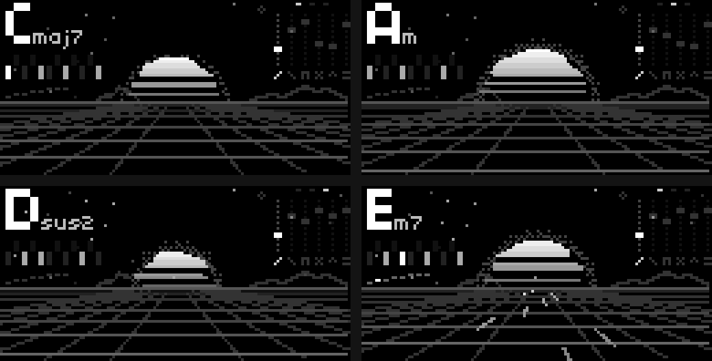
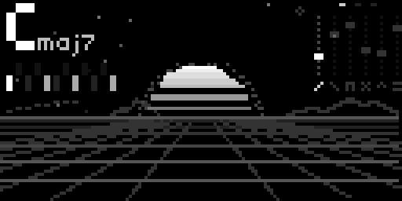
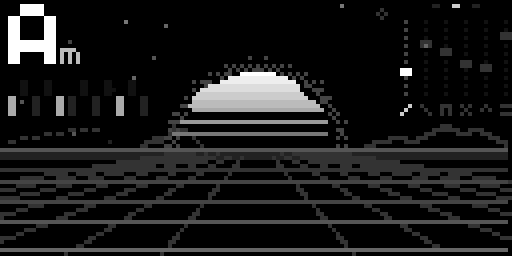
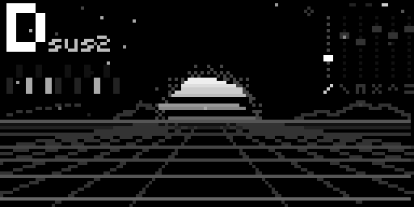
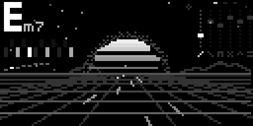

**English** · [Español](README.es.md) · [Français](README.fr.md) · [Deutsch](README.de.md) · [日本語](README.ja.md) · [中文](README.zh.md) · [हिन्दी](README.hi.md)

# Chordex 80

An '80s polysynth chord instrument for [monome norns](https://monome.org/docs/norns/).
One key plays a chord (the lowest key held sets the root) through a polysynth
engine with three models inspired by classic machines of the decade, while
the screen draws an outrun sunset.



**The scene is the synthesizer:**

- **the sun:** its size is the filter (E1), the halo is resonance, the stripes
  are distortion, the trembling is wobble, the ghosts on the sides are chorus
  (fatness), and its glow is the envelope breathing with what you play
- **stars** are shimmer, **sparks** are crackle (more than two keys held)
- **the grid** moves with the arpeggio tempo; every note is a light on the
  road

## Features

- **3 models**: D-50, CS80 and OMNI (inspired by the Roland D-50, Yamaha CS-80
  and ARP Omni), with a choice of attack for D-50 (air, pluck, none)
- **10 chords**: maj, min, dim, aug, 7, maj7, min7, m7b5, sus2, sus4
- **arpeggiator**: up, down, up-down, up x2, down x2, random and *arpa*
  (harp); the gate goes from very short to real legato (one voice that never
  cuts)
- **chord mode** on/off (off = single notes) and **hold**
- old-record crackle when more than two keys are held
- incoming MIDI clock only sets the arpeggio tempo, it never triggers notes;
  repeated notes on tempo do not retrigger the chord
- everything is saved on exit and comes back the same on load

<!-- u-ma:family -->
## The Chordex family

Same controls, different engines. Try the others:

| | |
|---|---|
| <a href="https://github.com/buenosairesfront/chordexfm"></a> | **[Chordex FM](https://github.com/buenosairesfront/chordexfm)**<br>4-operator FM, drawn as a flower<br>`;install https://github.com/buenosairesfront/chordexfm` |
| <a href="https://github.com/buenosairesfront/chordexstg"></a> | **[ChordexSTG](https://github.com/buenosairesfront/chordexstg)**<br>orchestral strings with real bowed-string motion<br>`;install https://github.com/buenosairesfront/chordexstg` |
| <a href="https://github.com/buenosairesfront/chordexwt"></a> | **[Chordex WT](https://github.com/buenosairesfront/chordexwt)**<br>wavetable: 8 banks of 8 waves, drawn as a 3D table<br>`;install https://github.com/buenosairesfront/chordexwt` |
| <a href="https://github.com/buenosairesfront/chordexchip"></a> | **[Chordex CHIP](https://github.com/buenosairesfront/chordexchip)**<br>chiptune: 8 console chips × 8 presets, drawn as a tracker<br>`;install https://github.com/buenosairesfront/chordexchip` |

**More from U-MA:** every instrument and tool in one place → [U-MA showcase](https://github.com/buenosairesfront/U-ma)
<!-- /u-ma:family -->

## Requirements

- norns (shield, standard or fates)
- a MIDI keyboard or controller

## Install

From maiden:

```
;install https://github.com/buenosairesfront/chordex80
```

Then **restart norns** (SYSTEM > RESTART) so the new engine `Chordex80` is
compiled, and load **chordex80** from SELECT.

## Controls

| control | action |
|---|---|
| E1 | filter |
| E2 | select parameter |
| E3 | adjust parameter |
| K3 + E1 | model: D-50 / CS80 / OMNI |
| K3 + E2 | resonance |
| K3 + E3 | chord type |
| K3 held (without turning) | chord mode on/off |
| K2 (tap) | arpeggiator on/off |
| K2 + E1 | arpeggio gate (max = legato) |
| K2 + E2 | arpeggio pattern |
| K2 + E3 | arpeggio speed |
| K1 held | hold on/off (filled dot left of the faders = held) |

**Faders:** attack, decay, distortion, shimmer, wobble, fatness.

**PARAMETERS menu:** MIDI channel (0 = all, the default), MIDI clock divider,
D-50 attack, hall, volume, and everything above.

## Gallery

| | |
|---|---|
|  D-50 · Cmaj7 |  CS80 · Am, open filter |
|  OMNI · Dsus2, closed filter |  arpeggio · Em7 |

## Credits

Made by [Buenos Aires Front](https://github.com/buenosairesfront) / U-MA.
Model names refer to the instruments that inspired them; this project is not
affiliated with Roland, Yamaha or ARP. Released under the MIT license.
